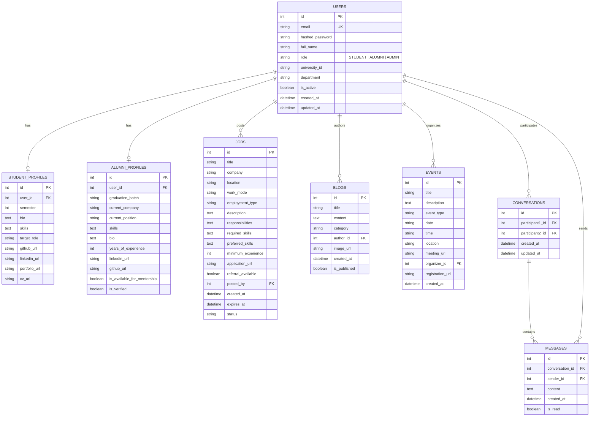

# CareerChain Database Design & Schema Specification

## 1. Overview
CareerChain uses a normalized relational database design managed via SQLAlchemy ORM. The platform supports standard MySQL (`mysql+pymysql://`) as well as an automatic, zero-configuration local fallback to SQLite (`sqlite:///./careerchain.db`).

---

## 2. Entity Relationship Summary

---

## 3. Data Dictionary

### Table: `users`
| Column | Type | Constraints | Description |
| :--- | :--- | :--- | :--- |
| `id` | INTEGER | PRIMARY KEY, AUTO_INCREMENT | Unique user identifier |
| `email` | VARCHAR(255) | UNIQUE, NOT NULL, INDEX | Login email address |
| `hashed_password` | VARCHAR(255) | NOT NULL | Bcrypt password hash |
| `full_name` | VARCHAR(255) | NOT NULL | User's legal/display name |
| `role` | VARCHAR(50) | NOT NULL, DEFAULT 'STUDENT' | Enum: `STUDENT`, `ALUMNI`, `ADMIN` |
| `university_id` | VARCHAR(50) | NULLABLE | DIU Student or Employee ID |
| `department` | VARCHAR(100) | NULLABLE | Academic Department (e.g. CSE, SWE, EEE) |
| `is_active` | BOOLEAN | NOT NULL, DEFAULT TRUE | Account active flag |
| `created_at` | DATETIME | NOT NULL | Timestamp of registration |
| `updated_at` | DATETIME | NOT NULL | Timestamp of last record update |

### Table: `student_profiles`
| Column | Type | Constraints | Description |
| :--- | :--- | :--- | :--- |
| `id` | INTEGER | PRIMARY KEY, AUTO_INCREMENT | Profile identifier |
| `user_id` | INTEGER | FOREIGN KEY (`users.id`), UNIQUE | References User |
| `semester` | INTEGER | DEFAULT 1 | Current academic semester (1-12) |
| `bio` | TEXT | NULLABLE | Self description |
| `skills` | TEXT | NULLABLE | Comma-separated or JSON list of skills |
| `target_role` | VARCHAR(100) | NULLABLE | Desired career specialization |
| `github_url` | VARCHAR(255) | NULLABLE | GitHub profile URL |
| `linkedin_url` | VARCHAR(255) | NULLABLE | LinkedIn profile URL |
| `portfolio_url` | VARCHAR(255) | NULLABLE | Personal portfolio website |
| `cv_url` | VARCHAR(255) | NULLABLE | Hosted CV / resume link |

### Table: `alumni_profiles`
| Column | Type | Constraints | Description |
| :--- | :--- | :--- | :--- |
| `id` | INTEGER | PRIMARY KEY, AUTO_INCREMENT | Profile identifier |
| `user_id` | INTEGER | FOREIGN KEY (`users.id`), UNIQUE | References User |
| `graduation_batch` | VARCHAR(50) | NULLABLE | Graduation year or batch |
| `current_company` | VARCHAR(255) | NULLABLE | Employer name |
| `current_position` | VARCHAR(255) | NULLABLE | Job title (e.g. Senior Software Engineer) |
| `skills` | TEXT | NULLABLE | Core skills and competencies |
| `bio` | TEXT | NULLABLE | Career summary and experience |
| `years_of_experience`| INTEGER | DEFAULT 0 | Professional work experience in years |
| `linkedin_url` | VARCHAR(255) | NULLABLE | LinkedIn profile URL |
| `github_url` | VARCHAR(255) | NULLABLE | GitHub profile URL |
| `is_available_for_mentorship` | BOOLEAN | DEFAULT TRUE | Willingness to mentor students |
| `is_verified` | BOOLEAN | DEFAULT FALSE | Verified by university administration |

### Table: `jobs`
| Column | Type | Constraints | Description |
| :--- | :--- | :--- | :--- |
| `id` | INTEGER | PRIMARY KEY, AUTO_INCREMENT | Job opening identifier |
| `title` | VARCHAR(255) | NOT NULL | Job role title |
| `company` | VARCHAR(255) | NOT NULL | Hiring company name |
| `location` | VARCHAR(255) | NOT NULL | City, Country or Remote |
| `work_mode` | VARCHAR(50) | DEFAULT 'Onsite' | `Remote`, `Onsite`, `Hybrid` |
| `employment_type` | VARCHAR(50) | DEFAULT 'Full-time' | `Full-time`, `Part-time`, `Internship`, `Contract` |
| `description` | TEXT | NOT NULL | Comprehensive job overview |
| `responsibilities` | TEXT | NULLABLE | Key responsibilities |
| `required_skills` | TEXT | NOT NULL | JSON list or comma list of mandatory skills |
| `preferred_skills` | TEXT | NULLABLE | JSON list or comma list of nice-to-have skills |
| `minimum_experience`| INTEGER | DEFAULT 0 | Required minimum years of experience |
| `application_url` | VARCHAR(255) | NULLABLE | Direct application link or email |
| `referral_available`| BOOLEAN | DEFAULT FALSE | Poster offers internal referral |
| `posted_by` | INTEGER | FOREIGN KEY (`users.id`) | Posting user (Alumni or Admin) |
| `created_at` | DATETIME | NOT NULL | Creation timestamp |
| `expires_at` | DATETIME | NULLABLE | Deadline timestamp |
| `status` | VARCHAR(50) | DEFAULT 'ACTIVE' | `ACTIVE`, `CLOSED`, `DRAFT` |
